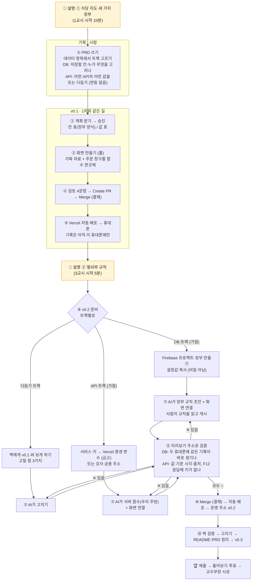

# 2차 흐름도: 기획에서 배포까지, 뿌리 강의 지도 위에서

> 강사용 검토 문서입니다. 2차 수업의 **처음 10분 설명**은 이 문서의 1·2장을 화면에 띄워 진행합니다.
> 연결 자료: 1차 [흐름도](../fire-ai/flow.html) (9단계) · 뿌리 강의 [AI 리터러시 · 웹 서비스의 뿌리](../ai-literacy/) (식당 비유 4강) · [2차-실습지.md](2차-실습지.md) · [2차-강의-계획안.md](2차-강의-계획안.md)

---

## 1. 한 장 흐름도

1차 흐름도의 9단계(기획 → 화면 → 연습장 → 결재 → 배포 → 휴대폰 → 기록은 이 휴대폰에만)를 그대로 지나간 뒤, **v0.2에서 두 갈래(DB / API)로 나뉘었다가 다시 같은 결재·배포 길로 합쳐집니다.**
📢 표시는 강사 설명이 들어가는 곳입니다.



글자만 보이는 화면에서는 아래 그림을 씁니다.

```
 📢 설명 ① 식당 지도 (1교시 10분)
   │
 ① PRD ─ 데이터 항목에서 트랙 고르기 (DB / API / 다듬기)
   │
 ② 계획·승인 ─▶ ③ 화면 v0.1 (가짜 자료) ─▶ ④ 검토·결재 ─▶ ⑤ 자동 배포·휴대폰      ← 1차와 같은 길
   │
 📢 설명 ② 열쇠와 규칙 (3교시 5분)
   │
 ⑥ 준비(사람) ─┬─ DB : Firebase 장부 만들기, 설정값
               ├─ API: 서비스 키를 Vercel 금고(환경 변수)에
               └─ 다듬기: 짝에게 v0.1을 써 보게 하고 고칠 점 3가지 (가점 없음)
   │
 ⑦ 연결(AI)  ─┬─ DB : 장부 규칙 초안 → 사람이 읽고 게시, 화면이 장부에 기록
               └─ API: 서버 함수(우리 주방)가 공공데이터포털에 주문, 화면은 우리 주방에만 주문
   │
 ⑧ 미리보기 검증 ──✕──▶ ⑦로
   │ ○
 ⑨ 결재·자동 배포 (v0.2) ─▶ ⑩ 짝 검증·정리 (v0.3) ─▶ 🏆 투표·시상
```

---

## 2. 식당 지도: 오늘 만드는 것이 뿌리 강의의 어디인가

뿌리 강의(AI 리터러시)는 웹 서비스를 **식당 하나**로 설명합니다. 2차 교육생은 이 강의를 듣지 않았으므로 사전 학습에서 필요한 절만 읽고 옵니다(홀 = 프론트엔드, 주문서 = API, 주방 = 백엔드, 장부 = 데이터베이스, 개업 = 배포). 1차와 2차에서 만드는 것을 같은 지도에 올리면 이렇습니다.

```
 1차    [홀: index.html] ── 손님이 각자 [수첩: localStorage] 에 적음
         프론트엔드(1강)        기록이 손님마다 따로 → "짝 휴대폰엔 안 보여요"

 2차 DB [홀] ══주문서══▶ [공용 장부: Firestore] + [장부 규칙]
                (API)      데이터베이스(3강)        인가·RLS(2강 6, 3강 11)
         주방을 직접 차리지 않고, 장부 회사(Firebase)가 주방 일까지 대신 (3강 5-3 서버리스, 11 합류)

 2차 API [홀] ══주문서══▶ [우리 주방: 서버 함수] ══주문서══▶ [거래처: 공공데이터포털]
                (fetch)    백엔드(2강)                (API)
                           [금고: 환경 변수] 에 거래처 출입증(서비스 키)   (4강 5 환경 변수)

 공통   [개업·자동 출시: GitHub → Vercel]  배포·CI/CD(4강 4·6·7)
```

| 2차에서 쓰는 말 | 식당 비유 | 뿌리 강의 |
|---|---|---|
| 화면 `index.html` | 홀·메뉴판 | 1강 프론트엔드 |
| localStorage | 손님 개인 수첩 | (1차 흐름도 9번) |
| API, 화면이 자료를 부르는 것 | 홀과 주방 사이의 **주문서** | 1강 10, 2강 5 |
| Firestore (Firebase) | **공용 장부**, 장부 회사가 관리 | 3강 5-2 NoSQL, 5-3 클라우드 DB·서버리스 |
| 장부 규칙 (`firestore.rules`) | 장부를 누가 보고·쓰고·고치나 | 2강 6 인증·인가, 3강 11 RLS |
| 새로고침 없이 바뀌는 목록 | 장부가 바뀌면 홀 전광판도 바로 | 3강 11 Realtime |
| Vercel 서버 함수 (`api/`) | **우리 주방** (작게, 필요할 때만 켜짐) | 2강 백엔드, 3강 5-3 서버리스 |
| 공공데이터포털 | 거래처 (남의 주방) | 2강 5 API |
| 서비스 키 | 거래처 출입증 (진짜 비밀) | 00 "API 키를 코드에 넣으면 왜 위험한지" |
| Vercel 환경 변수 | 주방 금고 | 4강 5 환경 변수 |
| 10분 캐시 | 자주 나가는 메뉴 미리 담아 두기 | 2강 7-2 캐시·TTL |
| GitHub 결재 → Vercel 자동 배포 | 신메뉴 자동 출시 | 4강 4 Git·GitHub, 6 CI/CD, 7 배포 플랫폼 |
| F12 → Network | 주문서·영수증 들여다보기 | 1강 2 HTTP 요청·응답 |
| 오류 번호 404·500·502 | "그런 메뉴 없음 / 주방 사고 / 거래처 응답 이상" | 00 HTTP 응답 번호 |

> 💡 **"API 트랙"이라는 이름에 대한 주의**: DB 트랙도 화면이 장부에 주문서(API)를 보냅니다. 두 트랙의 차이는 API를 쓰느냐가 아니라 **누구의 장부냐**입니다. DB 트랙 = 우리가 함께 쓰는 **우리 장부**, API 트랙 = 기관이 관리하는 **남의 장부를 읽기만**. 설명 ①에서 이 한 줄을 꼭 짚습니다.

---

## 3. 검토: DB·API 설명과 연동 작업은 어디에 들어가야 하나

### 3-1. 원칙

1. **설명은 "결정하기 직전"에.** 개념 설명이 결정보다 너무 앞서면 잊고, 뒤에 오면 이미 잘못 정한 뒤입니다.
   - 트랙과 저장할 칸은 **PRD에서** 정하므로 → 개념 설명(①)은 **1교시 PRD 직전**
   - 열쇠(서비스 키)와 규칙은 **3교시 준비 단계에서** 다루므로 → 보안 설명(②)은 **3교시 시작**
2. **연동 작업은 "사람 손 → AI 손 → 사람 눈" 순서로.**
   - 열쇠·규칙·장부 만들기는 **사람이 직접** (AI 채팅에 키를 넣지 않음)
   - 코드 연결은 **AI가**
   - 검증과 결재는 **사람이** 휴대폰·F12로
3. **v0.1에서 미리 자리를 만들어 둔다.** 가짜 자료로 만들되 주문 창구(저장·자료 받기 함수)를 한곳에 모아 두면, v0.2 연동이 "그 함수만 바꾸기"가 되어 4시간 안에 들어갑니다.

### 3-2. 단계별 배치표

| 흐름도 단계 | DB 트랙 연동 작업 | API 트랙 연동 작업 | 이때 할 설명 (뿌리 강의) | 이전 계획안 | 이번 반영 |
|---|---|---|---|---|---|
| 📢 설명 ① (1교시) | | | 식당 지도, 세 가지 장부, "우리 장부 vs 남의 장부" (1강 10, 2강 5, 3강 0·5-3) | 10분 설명에 키·규칙까지 몰아 넣음, 흐름도 없음 | **흐름도 + 식당 지도 중심으로**, 키·규칙은 ②로 이동 |
| ① PRD | 저장할 칸·누가 무엇을 고치나 | 어떤 API의 어떤 값 | | 반영됨 | 그대로 |
| ② 계획 | 칸 표 = 장부 양식 | 값 표 | | 반영됨 | 그대로 |
| ③ v0.1 만들기 | localStorage + 저장 함수 한곳 | 예시 자료 + 자료 받기 함수 한곳 | "주문 창구를 한곳에" (1강 10) | 지시문에만 있음 | 실습지에 **왜 그런지** 한 줄 추가 |
| ④⑤ 결재·배포 | | | 자동 출시 (4강 6·7). 1차 복습이라 설명 없이 | 반영됨 | 그대로 |
| 📢 설명 ② (3교시) | | | 열쇠와 규칙: 설정값(비밀 아님) vs 서비스 키(비밀), 금고(환경 변수), 장부 규칙 = 인가 (2강 6, 3강 11, 4강 5) | **없었음** (1교시에 앞당겨 있었음) | **3교시 시작 5분 신설** |
| ⑥ 준비 (사람) | Firebase 프로젝트·장부·설정값 | 키 → Vercel 환경 변수 / 강사 공용 주소 | | 15분 | 10분 (v0.1 대기 중 미리 하므로) |
| ⑦ 연결 (AI) | 규칙 초안 → 사람이 읽고 게시 / 화면 연결 | 서버 함수 + 화면 연결 | | 반영됨 | "심부름꾼" → **"우리 주방"** 으로 말 통일 |
| ⑧ 검증 (사람) | 두 휴대폰 실시간, 콘솔 데이터 탭 | 값·기준 시각·출처, F12 Network 응답에 키 없음 | 요청·응답 들여다보기, 오류 번호 읽기 (1강 2, 00 HTTP 응답 번호) | 확인 항목만 있음 | **오류 번호 읽는 표** 추가 |
| ⑨ 결재·배포 | | 캐시로 호출 한도 아끼기 (2강 7-2) | | 함수 예시에만 | 계획안 설명 ②에 한 줄 |
| ⑩ 정리·마무리 | 다음 걸음: 로그인·사람별 규칙 | 다음 걸음: 다른 API | 합류 (3강 11, 2강 6) | 반영됨 | 식당 지도로 마무리 |

### 3-3. 그 밖에 검토에서 본 것

- **교육생은 뿌리 강의를 듣지 않았습니다.** 그래서 2장 표의 뿌리 강의 절 중 2차에 꼭 필요한 것만 골라 **사전 학습**([2차-사전학습.md](2차-사전학습.md) ③)으로 읽게 했습니다(핵심 다섯 곳, 20분). 설명 ①은 복습이 아니라 **처음 소개**로, 홀·주문서·주방·장부·개업 다섯 줄을 천천히 합니다. 
- **사전 학습에서는 연동이 필수, 당일 산출물에서는 가점입니다.** Firebase·공공데이터 API는 사전 학습 ④·⑤에서 모두 1차 화면에 붙여 보게 하고(공공데이터는 주제와 관련이 없어도 연동 자체에 의미), 당일 산출물에 붙이면 가점(최대 +15)을 줍니다. 그래서 흐름도 ⑥에 연동하지 않는 **다듬기 트랙**(짝 의견으로 v0.2)을 세 번째 갈래로 두었습니다. 설명 ①·②는 트랙과 상관없이 모두 듣습니다.
- **CORS(브라우저가 남의 주소를 직접 부르는 것을 막는 것)** 는 뿌리 강의에 없는 말입니다. 용어는 쓰지 말고 "홀 직원이 거래처에 직접 주문하면 안 되고, 우리 주방을 거쳐야 한다"로만 설명합니다.
- 장부 규칙은 로그인이 없어 **주소를 아는 누구나 씁니다.** 투표 둘러보기 때 장난 기록이 쌓이면 그대로 "왜 로그인(2강 6)과 RLS(3강 11)가 필요한가"의 실례로 씁니다.

---

## 4. 이번에 고친 파일

| 파일 | 고친 것 |
|---|---|
| `2차-흐름도.md` | 새 파일 (이 문서) |
| `2차-사전학습.md` · `2차-심사기준.md` | 뒤에 추가: 뿌리 강의 필요한 절만 사전 학습 + Firebase·API **필수 실습**, 기본 100점 + 연동 가점 최대 +15 |
| `2차-실습지.md` | 맨 앞에 흐름도와 식당 지도, v0.1 "주문 창구를 한곳에" 이유, 3교시 시작 설명 ② 자리, 단계 5를 10분으로, 단계 7에 오류 번호 읽는 표, "심부름꾼" → "우리 주방" |
| `2차-강의-계획안.md` | 시간표에 설명 ① (흐름도·식당 지도) / 설명 ② (열쇠와 규칙, 3교시 5분) 나눔, 설명 원고를 두 개로 다시 씀 |
