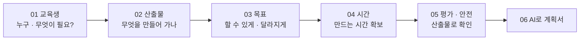

# 교육생 맞춤 강의 설계 — 그 사람에게 맞는 산출물로

## 왜 이 강의인가

요즘 강의는 대부분 **도구 사용법** 실습입니다. "AI로 이미지 만들기", "엑셀 함수 익히기"처럼 도구가 주인공입니다. 그런데 같은 도구라도 **누가 배우느냐**에 따라 들고 돌아가야 할 것이 전혀 다릅니다.

```cards
🌱 | 마음 돌봄 프로그램 참여자 | 내 마음 날씨 그림책 | 감정을 말 대신 그림으로 꺼내 보기
🗂 | 행정 공무원 | 엑셀 병합 자동화 도구 | 매달 손으로 하던 취합 30분 → 1분
🤝 | 조직문화 워크숍 직원 | 상사와 나, 풍자 4컷 만화 | 웃음으로 꺼내는 공감, 대화의 계기
🚒 | 신임 소방 교육생 | 출동 전 장비 점검 체크 화면 | 현장에서 바로 쓰는 내 점검표
👵 | 복지관 시니어 | 손주에게 보내는 AI 그림 안부 카드 | "나도 할 수 있다" 자신감, 가족과 이어지기
🧒 | 중학생 (소방안전 체험) | 우리 집 화재 대피 지도 + 119 신고 카드 | 집에 가서 가족과 대피 계획 세우기
```

> [!tip] 오늘의 한 문장
> 좋은 실습 강의는 **"이 도구를 배운다"**가 아니라 **"이 사람이 이것을 만들어 간다, 그리고 그것 자체가 효과다"**로 설계합니다.

## 오늘 손에 쥐는 것

강의가 끝나면 **내 교육생에게 맞춘 강의계획서 한 장**이 남습니다. 교육생 카드 → 산출물 → 목표 → 시간표 → 평가 순서로 각 장의 "바로 해 보기"에 적은 내용이 마지막 [[강의설계_06_AI로_강의계획서]]의 계획서 칸으로 이어지고, PDF로 저장할 수 있습니다.

## 강의 순서 (약 90분)

| 장 | 핵심 질문 | 시간 | 바로 해 보기 |
|---|---|---|---|
| 00 강의 안내 | 왜 교육생 맞춤인가? | 5분 | — |
| [[강의설계_01_교육생이해]] | 내 교육생은 **누구이고 무엇이 필요한가**? | 12분 | 교육생 카드 만들기 |
| [[강의설계_02_산출물중심_주제선정]] | 그 사람이 **무엇을 만들어 가면** 효과가 날까? | 18분 | 교육생 카드 뽑기 · 내 산출물 깔때기 · 즉석 주제 정하기 |
| [[강의설계_03_학습목표]] | 끝나고 무엇을 **할 수 있게, 어떻게 달라지게**? | 12분 | 목표 판정 · ABCD 목표 조립 |
| [[강의설계_04_내용구성_시간배분]] | **만드는 시간**을 어떻게 확보할까? | 12분 | 시간 블록 짜기 |
| [[강의설계_05_방법_평가_안전]] | 산출물을 어떻게 **확인하고, 사람을 어떻게 지킬까**? | 12분 | 목표 · 방법 · 평가 맞추기 |
| [[강의설계_06_AI로_강의계획서]] | AI에게 무엇을 맡기고 무엇을 **내가 볼까**? | 15분 | 맞춤 강의계획서 만들기 |
| 마무리 | 내 강의 한 줄 나누기 | 4분 | 채팅에 "내 교육생 → 산출물 → 효과" 한 줄 |



> [!tip] 장마다 "방법 모음" 카드가 있습니다
> 강사는 상황마다 다른 방법이 필요합니다. 교육생 파악 8가지 · 주제 정하는 방식 8가지 · 목표 문장 틀 6가지 · 열기 8가지 · 나누기 6가지 · 피드백 6가지 · AI 활용 6가지를 카드로 모았습니다. 내 강의에 맞는 것을 골라 쓰세요.

## 오늘 계속 쓰는 세 가지 예시

모든 장에서 세 교육생을 나란히 따라갑니다. 내 교육생이 있으면 그 사람으로 바꿔 적으세요.

| | 🌱 마음 돌봄 | 🗂 행정 공무원 | 🤝 조직문화 |
|---|---|---|---|
| 교육생 | 우울감 · 스트레스를 겪는 성인 8명 (상담센터 연계 프로그램) | 매달 부서별 엑셀을 손으로 합치는 주무관 15명 | 세대 · 직급이 섞인 한 부서 직원 20명 |
| 필요 | 감정을 꺼내 말하기 어렵다 | 반복 취합에 시간을 뺏긴다 | 상사와 대화가 어렵고 분위기가 무겁다 |
| 산출물 | 내 마음 날씨 그림책 | 엑셀 병합 자동화 도구 | 상사와 나, 풍자 4컷 만화 |
| AI 도구 | 이미지 생성 AI (🎵 위로의 노래로 바꿔도 좋음) | 대화형 AI (매크로 · 스크립트 작성) | 이미지 생성 AI (🎵 팀 응원가로 바꿔도 좋음) |

> [!tip] 시니어 · 청소년도 있습니다
> 수업 설명은 위 세 예시로 진행하고, **👵 시니어**와 **🧒 청소년** 예시는 각 장 표의 한 줄과 "바로 해 보기"의 예시 버튼으로 넣었습니다. 내 교육생과 가장 가까운 예시를 골라 따라 하면 됩니다. 수업 시간은 그대로입니다.

| | 👵 시니어 | 🧒 청소년 |
|---|---|---|
| 교육생 | 스마트폰이 낯선 복지관 어르신 12명 | 소방안전 체험에 온 중학생 25명 |
| 필요 | 디지털이 두렵고, 멀리 사는 가족과 소식이 뜸하다 | 화재 대피를 "알기만" 하고 집에서 해 본 적이 없다 |
| 산출물 | 손주에게 보내는 AI 그림 안부 카드 | 우리 집 화재 대피 지도 + 119 신고 연습 카드 |
| AI 도구 | 이미지 생성 AI (음성 입력) | 이미지 생성 AI · 대화형 AI |

## 줌에서 이렇게 참여합니다

| 할 일 | 방법 |
|---|---|
| 자료 보기 | 강사 화면 공유를 보면서, **이 사이트를 내 브라우저에서 따로 엽니다** |
| 답 나누기 | "채팅에 한 줄" 표시가 나오면 줌 채팅창에 짧게 올립니다 |
| 해 보기 | 각자 입력합니다. 적은 내용은 **내 브라우저에만 저장**되고 어디에도 전송되지 않습니다 |
| 화면 크게 | 오른쪽 아래 **[강의 모드]** (또는 P 키) |

> [!warning] 개인정보는 넣지 않습니다
> 교육생 카드와 AI 요청에는 실제 이름, 진단명, 연락처, 내부 문서 원문을 넣지 않습니다. "30대 행정직 주무관"처럼 **유형**으로만 적습니다.

## 이 접근이 낯설지 않은 이유

교육 설계에서는 오래전부터 **학습자 중심**과 **산출물(프로젝트) 기반 학습**을 강조해 왔습니다. 공공HRD 콘테스트 교수학습 분야 내용심사 항목도 같은 순서를 봅니다.

| 오늘의 장 | 내용심사 항목 (배점) | 심사 기준 요약 |
|---|---|---|
| 01 교육생 이해 | ① 요구분석 (5) | 학습환경, 교육수요자, 관련 정책 · 직무 · 과제 분석의 적절성 |
| 02 · 03 산출물 · 목표 | ② 교육목표 (5) | 교육목표의 타당성, 명확성 |
| 04 내용 · 시간 | ③ 학습내용 (20) | 실제 활용 가능성, **교육수요자 요구분석 결과 반영** |
| 05 방법 · 평가 | ④ 교수학습전략 (10) · ⑤ 학습평가 (10) | **학습자 중심 교수전략**, 평가 방법과 체계성 |
| 06 AI 활용 | 가점: AI 활용 (+3) | **학습자의 요구 수준 반영**, 교육의 개선 정도 |

> [!note] 참고
> 학습자 분석 · ADDIE 모형, 프로젝트 기반 학습(PBL), Mager의 ABCD 목표 진술, Bloom의 교육목표 분류(인지 · 정의적 영역), Gagné의 수업 사태를 강의용으로 간추렸습니다.
