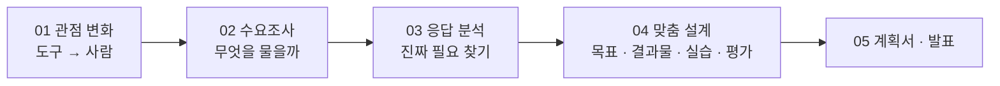

# AI 강사를 위한 수요조사 기반 맞춤형 교육과정 설계

## 강의의 핵심 메시지

> [!tip] AI를 가르치기 전에 사람을 먼저 이해하라
> 이 강의는 생성형 AI 활용법을 가르치는 강의가 아닙니다. 교육생의 **직업과 업무환경, 생활 속 문제**를 파악하고, 그 목적에 맞는 AI 교육과정을 설계하는 방법을 다룹니다.

AI 사용법을 먼저 가르치지 않습니다. 교육생이 **어떤 일을 하는지, 무엇이 불편한지, 무엇을 해결하고 싶은지**를 먼저 조사하고, 그다음에 AI를 해결 도구로 연결합니다.

```flow
✓ AI 강사의 교육 설계 역량 | 📋 수요조사 > 🔍 문제 발견 > 🎯 교육 목표 설정 > 🧩 맞춤형 실습 설계 > 🚀 현장 적용
```

## 오늘 손에 쥐는 것

강의가 끝나면 **나만의 맞춤형 AI 강의계획서 한 편**이 남습니다. 각 장의 "바로 해 보기"에 적은 설문 · 분석 결과 · 목표 · 시간표 · 평가가 마지막 [[강의설계_05_강의계획서_발표]]의 계획서 칸으로 이어지고, PDF로 저장할 수 있습니다.

## 강의 구성 (총 1시간 10분)

| 시간 | 장 | 강의 내용 | 교육 방식 | 수업 중 바로 해 보기 |
|---|---|---|---|---|
| 10분 | 00 안내 · [[강의설계_01_관점변화]] | 핵심 메시지, AI 교육의 관점 변화 | 강의 및 사례 | — |
| 15분 | [[강의설계_02_수요조사설계]] | 교육생 수요조사 방법 | 설문 설계 실습 | **실습 1. 수요조사 설문 만들기** (7분) |
| 15분 | [[강의설계_03_응답분석]] | 수요조사 결과 분석 | AI 활용 실습 | **응답 분석 연습** (7분) |
| 20분 | [[강의설계_04-1_교육목표]] ~ [[강의설계_04-4_평가_성과_안전]] | 직업 · 상황별 맞춤 교육과정 설계 | 설명 · 조별 실습 | **ABCD 목표 조립** (4분) |
| 10분 | [[강의설계_05_강의계획서_발표]] | 강의계획서 완성 · 발표 및 피드백 | 발표 | **맞춤 강의계획서** (5분) |

> [!info] 70분에 맞춰 핵심만 다룹니다
> 수업에서 다루지 않는 절은 **📖 수업 뒤 읽을거리**로 접혀 있고, 나머지 바로 해 보기는 **더 해 보기 · 수업 뒤**로 접혀 있습니다. 눌러서 펼치면 언제든 볼 수 있습니다.



## 조별 최종 프로젝트

교육생(강사)을 4개 팀으로 나누어, 팀마다 하나의 맞춤형 AI 교육과정을 설계합니다. 02~05장의 바로 해 보기에서 **우리 팀 교육생 예시 버튼**을 눌러 따라가면 됩니다.

```cards
🤝 | 1팀 | 직장 조직문화 개선 AI 교육 | 부서 간 소통 부족 · 세대 갈등 · 회의 비효율
🏪 | 2팀 | 소상공인 영업 활성화 AI 교육 | 홍보 부족 · 고객 유입 감소 · 단골 관리
🌱 | 3팀 | 마음 돌봄 및 자기성찰 AI 교육 | 스트레스 · 자기이해 부족 · 일상 속 고민
🗂 | 4팀 | 공공기관 업무 혁신 AI 교육 | 반복 보고서 · 민원 응대 · 자료 정리
```

> [!note] 더 해 보기
> 시간이 남는 팀이나 수업 뒤에는 **교육자(강사 역량 강화)**, **복지관 시니어**, **청소년(소방안전 체험)** 예시로도 같은 흐름을 해 볼 수 있습니다.

## 줌에서 이렇게 참여합니다

| 할 일 | 방법 |
|---|---|
| 자료 보기 | 강사 화면 공유를 보면서, **이 사이트를 내 브라우저에서 따로 엽니다** |
| 답 나누기 | "채팅에 한 줄" 표시가 나오면 줌 채팅창에 짧게 올립니다 |
| 조별 실습 | 줌 **소회의실**에서 팀별로 진행하고, 결과는 채팅 · 화면 공유로 나눕니다 |
| 해 보기 | 적은 내용은 **내 브라우저에만 저장**되고 어디에도 전송되지 않습니다 |
| 화면 크게 | 오른쪽 아래 **[강의 모드]** (또는 P 키) |

> [!warning] 개인정보는 넣지 않습니다
> 설문 응답 · 교육생 정보 · AI 요청에는 실제 이름, 연락처, 진단명, 내부 문서 원문을 넣지 않습니다. 실습은 **가상의 응답**으로 하고, 실제 설문을 돌릴 때도 AI에는 익명 · 요약본만 넣습니다.

## 이 흐름이 낯설지 않은 이유

교육 설계에서는 오래전부터 **요구분석(수요조사) → 설계 → 개발 → 실행 → 평가**(ADDIE)를 기본으로 삼아 왔습니다. 공공HRD 콘테스트 교수학습 분야 내용심사 항목도 같은 순서를 봅니다.

| 오늘의 장 | 내용심사 항목 (배점) | 심사 기준 요약 |
|---|---|---|
| 02 · 03 수요조사 · 분석 | ① 요구분석 (5) | 학습환경, 교육수요자, 관련 정책 · 직무 · 과제 분석의 적절성 |
| 4-1 교육 목표 | ② 교육목표 (5) | 교육목표의 타당성, 명확성 |
| 4-2 · 4-3 결과물 · 실습 | ③ 학습내용 (20) | 실제 활용 가능성, **교육수요자 요구분석 결과 반영** |
| 4-4 평가 · 성과 | ④ 교수학습전략 (10) · ⑤ 학습평가 (10) | **학습자 중심 교수전략**, 평가 방법과 체계성 |
| 05 AI 활용 | 가점: AI 활용 (+3) | **학습자의 요구 수준 반영**, 교육의 개선 정도 |

> [!note] 참고
> 요구분석 · ADDIE 모형, 프로젝트 기반 학습(PBL), Mager의 ABCD 목표 진술, Bloom의 교육목표 분류, Kirkpatrick의 교육 성과 평가를 강의용으로 간추렸습니다.
