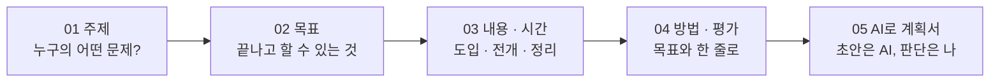

# 강의 설계 워크숍 — 주제 선정부터 강의계획서 한 장까지

## 오늘 손에 쥐는 것

강의가 끝나면 **내 강의계획서 한 장**이 남습니다. 각 장의 "바로 해 보기"에서 적은 내용이 마지막 [[강의설계_05_AI로_강의계획서|05 AI로 강의계획서 완성하기]]의 계획서 칸으로 자동으로 이어지고, 그대로 PDF로 저장할 수 있습니다.

> [!tip] 오늘의 약속
> 설명은 짧게, 해 보기는 많이. 장마다 **설명 → 바로 해 보기 → 3문항 퀴즈** 순서로 진행합니다. 내 강의 주제가 아직 없어도 괜찮습니다. 예시 주제로 따라 하다가 중간에 내 것으로 바꿔도 됩니다.

## 강의 순서 (약 85분)

| 장 | 주제 | 핵심 질문 | 시간 | 바로 해 보기 |
|---|---|---|---|---|
| 00 | 강의 안내 | 오늘 무엇을 만들까? | 5분 | — |
| 01 | [[강의설계_01_주제선정]] | 무엇을 가르쳐야 **필요한** 강의가 될까? | 15분 | 주제 깔때기 · 주제 고르기 |
| 02 | [[강의설계_02_학습목표]] | 끝나고 무엇을 **할 수 있게** 될까? | 15분 | 목표 판정 · ABCD 목표 조립 |
| 03 | [[강의설계_03_내용구성_시간배분]] | 50분을 어떻게 **나눌까**? | 15분 | 시간 블록 짜기 |
| 04 | [[강의설계_04_교수방법_평가]] | 무엇으로 가르치고 무엇으로 **확인할까**? | 12분 | 목표 · 방법 · 평가 맞추기 |
| 05 | [[강의설계_05_AI로_강의계획서]] | AI에게 무엇을 맡기고 무엇을 **내가 볼까**? | 18분 | 강의계획서 만들기 |
| — | 퀴즈 결과 공유판 | 함께 돌아보기 | 5분 | — |

## 줌에서 이렇게 참여합니다

| 할 일 | 방법 |
|---|---|
| 자료 보기 | 강사 화면 공유를 보면서, **이 사이트를 내 브라우저에서 따로 엽니다** (해 보기는 각자 내 화면에서) |
| 답 나누기 | "채팅에 한 줄" 표시가 나오면 줌 채팅창에 짧게 올립니다 |
| 해 보기 | 각자 입력합니다. 적은 내용은 **내 브라우저에만 저장**되고 어디에도 전송되지 않습니다 |
| 퀴즈 | 장 끝의 3문항 퀴즈만 이름과 답이 서버로 갑니다. 결과는 마지막 공유판에서 함께 봅니다 |
| 화면 크게 | 오른쪽 아래 **[강의 모드]** (또는 P 키): 목차를 숨기고 글자를 키웁니다 |

> [!warning] 개인정보는 넣지 않습니다
> 해 보기와 AI 요청에는 실제 교육생 이름, 연락처, 내부 문서 원문을 넣지 않습니다. 이 사이트의 입력은 내 브라우저에만 남지만, AI 서비스에 붙여넣는 순간 밖으로 나갑니다.

## 오늘 계속 쓰는 예시

모든 장에서 같은 예시 하나를 따라갑니다. 내 주제가 있으면 예시 대신 내 것을 적으세요.

| 항목 | 예시 |
|---|---|
| 대상 | 소방학교 **신임 교육생** 24명 (공기호흡기를 처음 다룸) |
| 문제 | 현장 실습에서 착용 전 점검을 빠뜨리거나 순서가 뒤섞임 |
| 강의 | **공기호흡기 착용 전 점검** · 1차시 50분 |
| 목표 | 교육생은 점검표를 보며 3분 안에 착용 전 점검 5단계를 빠짐없이 수행한다 |

## 이 순서가 낯설지 않은 이유

강의를 설계하는 순서는 어디서나 비슷합니다. 교육 설계의 기본 틀인 **ADDIE**(분석 → 설계 → 개발 → 실행 → 평가)의 앞부분이고, 공공HRD 콘테스트 교수학습 분야 **내용심사 항목**과도 그대로 겹칩니다.

| 오늘의 장 | 내용심사 항목 (배점) | 심사 기준 요약 |
|---|---|---|
| 01 주제 선정 | ① 요구분석 (5) | 학습환경, 교육수요자, 관련 정책 · 직무 · 과제 분석의 적절성 |
| 02 학습목표 | ② 교육목표 (5) | 교육목표의 타당성, 명확성 |
| 03 내용 구성 | ③ 학습내용 (20) | 내용의 적절성, 체계성, 실제 활용 가능성, 요구분석 결과 반영 |
| 04 방법 · 평가 | ④ 교수학습전략 (10) · ⑤ 학습평가 (10) | 동기 유발, 학습자 중심 전략, 평가 방법과 체계성 · 일관성 |
| 05 AI 활용 | 가점: AI 활용 (+3) | 필요성 · 적절성, 학습자 요구 반영, 교육 개선 정도 |

> [!note] 참고
> 오늘 쓰는 틀은 교육공학에서 널리 쓰는 것들입니다. ADDIE 모형, Mager의 ABCD 목표 진술, Bloom의 개정 교육목표 분류, Gagné의 9가지 수업 사태를 강의용으로 간추렸습니다.
