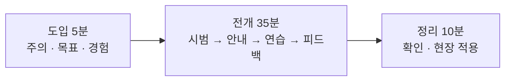

# 03 내용 구성과 시간 배분 — 50분을 어떻게 나눌까

## 1. 목표에서 내용으로: 세 개의 원

목표가 정해지면 내용은 목표에서 거꾸로 고릅니다. 내가 아는 것을 모두 넣지 않고, 세 개의 원으로 나눕니다.

| 원 | 기준 | 공기호흡기 예 | 강의에서 |
|---|---|---|---|
| 🎯 **꼭 알아야 할 것** | 이것 없이는 목표 행동을 못 한다 | 점검 5단계, 압력 기준, 면체 밀착 확인 | 반드시 · 충분한 시간 |
| 👍 **알면 좋은 것** | 도움이 되지만 없어도 행동은 된다 | 공기호흡기 구조와 원리, 제조사별 차이 | 시간이 남으면 · 자료로 |
| 📚 **몰라도 되는 것** | 목표와 직접 관계없다 | 공기호흡기의 역사, 해외 규격 비교 | 빼거나 참고자료로 |

> [!tip] 한 줄 정리
> 시간이 모자라면 **"알면 좋은 것"부터** 뺍니다. "꼭 알아야 할 것"과 그것을 연습하는 시간은 끝까지 지킵니다.

## 2. 도입 · 전개 · 정리

한 차시는 세 덩어리로 짭니다. 각 덩어리에서 할 일은 정해져 있습니다.

| 단계 | 할 일 | 공기호흡기 예 |
|---|---|---|
| **도입** (약 10%) | ① 주의 끌기 ② 목표 알리기 ③ 이전 경험 떠올리기 | 점검 누락으로 생긴 아차사고 장면 → "오늘 끝나면 3분 안에 점검합니다" → "장비 점검해 본 적 있나요?" |
| **전개** (약 70%) | ④ 내용 보여 주기 ⑤ 안내하기 ⑥ 연습시키기 ⑦ 피드백 | 5단계 시범 → 점검표 안내 → 짝 실습 → 강사 순회 피드백 |
| **정리** (약 20%) | ⑧ 확인(평가) ⑨ 현장에 옮기기 | 3분 점검 실연 확인 → "출동 전 점검표는 차량에 비치" |

> [!note] 참고
> 위 ①~⑨는 Gagné의 9가지 수업 사태를 강의 현장에 맞게 줄인 것입니다. 순서를 외우기보다 **각 덩어리에서 빠진 것이 없는지** 점검하는 데 씁니다.

## 3. 10분 규칙: 설명이 길어지면 활동 하나

사람의 집중은 설명만 들을 때 10~15분이 지나면 눈에 띄게 떨어집니다. 그래서 설명 블록 사이에 **짧은 활동**을 끼웁니다.

| 활동 | 걸리는 시간 | 예 |
|---|---|---|
| 질문 하나 던지기 | 1~2분 | "압력계가 몇 bar면 쓰면 안 될까요?" |
| 짝과 확인 | 3분 | 점검표를 서로 읽어 주기 |
| 짧은 실습 | 5~10분 | 짝 실습, 체크리스트로 서로 확인 |
| 미니 퀴즈 | 2분 | OX 3문항 |

> [!warning] 줌 강의라면 더 짧게
> 화면 너머의 집중은 더 빨리 떨어집니다. 줌에서는 **7~10분마다** 채팅 한 줄, 반응 이모지, 투표, 주석 같은 참여를 넣습니다.

## 4. 시간 배분 예시: 공기호흡기 착용 전 점검 (50분)

| 시간 | 단계 | 내용 | 방법 |
|---|---|---|---|
| 0~5분 | 도입 | 아차사고 장면, 오늘의 목표, 경험 묻기 | 질문 · 사진 |
| 5~15분 | 전개 ① | 점검 5단계 시범과 설명 | 시범 · 설명 |
| 15~25분 | 활동 ① | 짝 실습: 점검표 보며 따라 하기 | 실습 |
| 25~33분 | 전개 ② | 자주 틀리는 곳 3가지, 압력 기준 | 설명 · 사례 |
| 33~43분 | 활동 ② | 3분 점검 실연, 짝이 체크리스트로 확인 | 실습 · 평가 |
| 43~50분 | 정리 | 결과 공유, 현장 적용 약속 | 토의 |

설명(전개 ①, ②)이 10분을 넘지 않고, 그 사이마다 활동이 들어가 있습니다. 활동 ②는 그대로 **평가**가 됩니다.

## 5. 줌 강의일 때 바꿀 것

| | 교실 | 줌 |
|---|---|---|
| 주의 끌기 | 장비 실물 보여 주기 | 화면 공유 사진 · 짧은 영상, 이름 불러 질문 |
| 참여 | 손 들기, 짝 활동 | 채팅 한 줄, 반응 이모지, 투표, 소회의실 |
| 실습 | 실물 장비 | 실습이 필요한 목표는 **대면 차시로 분리**하거나, 시연 영상 + 체크리스트 판정으로 바꾸기 |
| 자료 | 유인물 | 링크 하나로 (이 사이트처럼) |
| 확인 | 순회하며 보기 | 채팅 · 퀴즈 결과 · 화면 공유로 확인 |

## 정리

1. 내용은 목표에서 거꾸로: **꼭 알아야 할 것**에 시간을 몰아줍니다.
2. **도입 · 전개 · 정리**의 할 일을 빠뜨리지 않습니다.
3. 설명은 10분(줌은 7~10분)을 넘기지 말고 **활동을 끼웁니다**.
